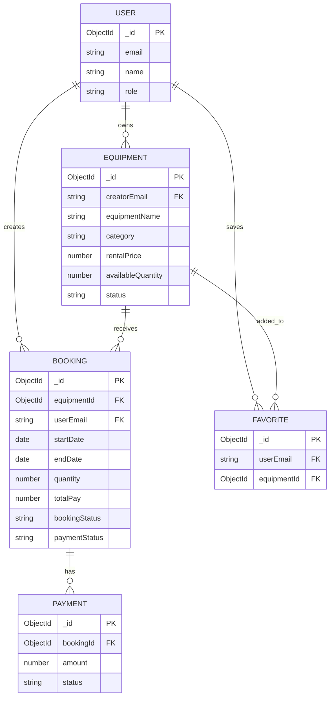

# Equipment Rental Platform

A full-stack web application that connects equipment owners with customers who want to rent equipment. Users can explore available equipment, book rentals, make secure online payments, and manage their rental activities through role-based dashboards.

## Live Demo

- **Client:** [Equipment Rental Platform](https://equipment-rental-platform-ochre.vercel.app/)
- **Server API:** [Backend Server](https://equipment-rental-platform-server-seven.vercel.app/)

## GitHub Repositories

- **Client Repository:** [equipment-rental-platform](https://github.com/rakibhossendev/equipment-rental-platform)
- **Server Repository:** [equipment-rental-platform-server](https://github.com/rakibhossendev/equipment-rental-platform-server)

## Project Purpose

The purpose of this platform is to make equipment rental easier and more accessible. Equipment owners can list and manage their equipment, while customers can find suitable equipment, check availability, book rentals, and complete payments online.

The platform also provides an administration system to manage users, equipment listings, and rental activities.

## Key Features

- **Authentication:** User registration and login with email/password and Google authentication.
- **Role-Based Access Control:** Separate permissions and dashboards for Admin, Owner, and Customer.
- **Equipment Management:** Owners can add, view, and manage their equipment listings.
- **Equipment Discovery:** Browse equipment with search, filtering, and sorting options.
- **Equipment Details:** View equipment information, pricing, availability, and rental terms.
- **Rental Booking:** Customers can select rental dates and quantities and calculate rental costs.
- **Online Payments:** Rental payments through Stripe Checkout.
- **Favorites:** Customers can save and manage their favorite equipment.
- **Owner Dashboard:** Manage equipment listings and monitor customer rental bookings.
- **Customer Dashboard:** Manage personal information, rentals, and favorite equipment.
- **Admin Dashboard:** Manage users, review equipment listings, and oversee rental activities.
- **Profile Management:** Users can view and update their profile information.
- **Responsive Design:** Interface optimized for desktop, tablet, and mobile devices.

## User Roles

| Role | Capabilities |
|---|---|
| Admin | Manage users, approve or reject equipment, manage listings, and monitor rentals. |
| Owner | Add and manage equipment and view rental bookings for owned equipment. |
| Customer | Browse equipment, book rentals, make payments, and manage favorites and rentals. |

## Technology Stack

### Frontend
- Next.js
- React
- TypeScript
- Tailwind CSS
- shadcn/ui
- Lucide React

### Backend
- Node.js
- Express.js
- JavaScript
- MongoDB Native Driver

### Authentication & Payment
- Better Auth
- JSON Web Tokens (JWT)
- Stripe Checkout

### Deployment
- Vercel

## Database System

The application uses **MongoDB**, a NoSQL document-oriented database, with the MongoDB Native Driver for database operations.

The database contains the following main collections:

| Collection | Purpose |
|---|---|
| `user` | Stores user accounts and profile information. |
| `equipments` | Stores equipment listings, descriptions, rental prices, availability, and owner information. |
| `bookings` | Stores customer rental bookings, rental dates, quantities, amounts, and booking statuses. |
| `payments` | Stores payment-related records and transaction information. |
| `favorites` | Stores customers' favorite equipment references. |

### Entity Relationship (ER) Diagram

The following diagram illustrates the logical relationships between the main database entities.



**Note:** This is a conceptual ER diagram showing the main entities and their intended relationships. MongoDB is a NoSQL database, so these relationships are implemented using document references and application-level queries rather than traditional relational database foreign-key constraints. Verify the exact field names and payment-to-booking relationship against the backend implementation before treating this as the final physical schema.

## Important npm Packages

The following packages are used in the client application:

| Package | Purpose |
|---|---|
| `next` | React framework for the application |
| `react` | Building user interfaces |
| `react-dom` | Rendering React components |
| `typescript` | Static type checking |
| `tailwindcss` | Utility-first CSS styling |
| `@tailwindcss/postcss` | Tailwind CSS integration |
| `lucide-react` | Icons |
| `better-auth` | Authentication |
| `sonner` | Toast notifications |
| `framer-motion` | UI animations |
| `react-hook-form` | Form state management |
| `zod` | Schema validation |
| `@hookform/resolvers` | Form validation integration |
| `recharts` | Data visualization |
| `date-fns` | Date formatting and manipulation |

*Check the package list against the actual client `package.json` before final submission.*

## Installation and Setup

### Prerequisites

- Node.js
- npm
- Git

### 1. Clone the Repository

```bash
git clone https://github.com/rakibhossendev/equipment-rental-platform.git
```

### 2. Navigate to the Project Directory

```bash
cd equipment-rental-platform
```

### 3. Install Dependencies

```bash
npm install
```

### 4. Configure Environment Variables

Create a `.env.local` file in the root directory and configure the required environment variables.

Use the actual environment variable names from the project's environment configuration. Never commit real secrets or credentials.

### 5. Run the Development Server

```bash
npm run dev
```

Open [http://localhost:3000](http://localhost:3000) in your browser.

## Available Scripts

```bash
npm run dev      # Start the development server
npm run build    # Build the application for production
npm run start    # Start the production server
npm run lint     # Run ESLint
```

## Backend Repository

The backend is maintained in a separate repository.

[View Backend Source Code](https://github.com/rakibhossendev/equipment-rental-platform-server)

## Deployment

The frontend and backend are deployed separately using Vercel.

- **Frontend:** https://equipment-rental-platform-ochre.vercel.app/
- **Backend:** https://equipment-rental-platform-server-seven.vercel.app/

## License

This project was developed as an academic project.